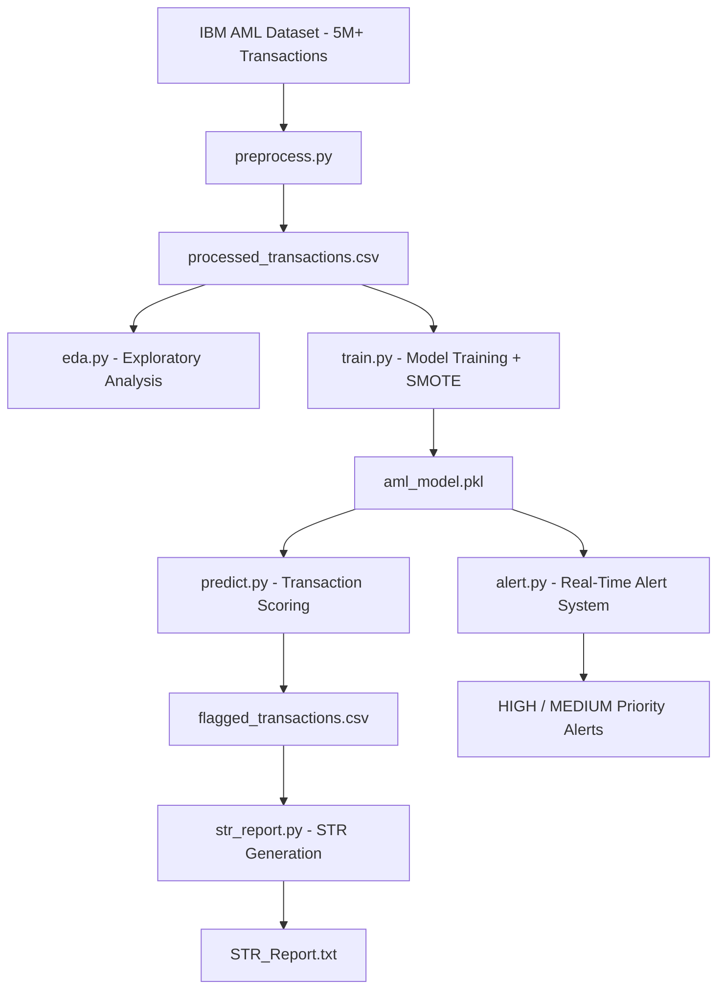
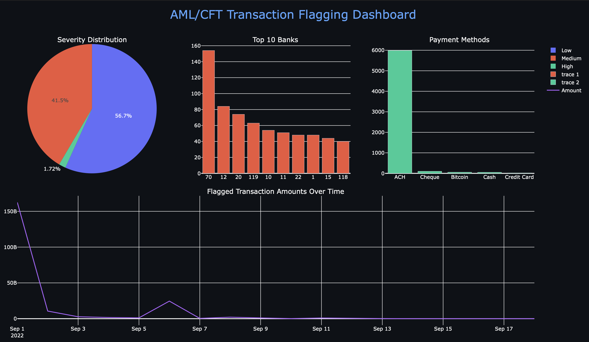

# AML/CFT Transaction Flagging System

## 1. Overview
An end-to-end Anti-Money Laundering (AML) and Counter-Financing of Terrorism (CFT) transaction flagging system built on IBM's synthetic financial dataset of 5M+ transactions. The system uses machine learning to detect suspicious financial activity, assigns severity levels based on FATF typologies, generates automated Suspicious Transaction Reports (STR), and surfaces real-time HIGH/MEDIUM priority alerts for compliance review.

---

## 2. Tech Stack

### Machine Learning
* Scikit-learn
* Random Forest Classifier
* Isolation Forest
* SMOTE (Imbalanced-learn)

### Data Processing
* Python
* Pandas
* NumPy

### Reporting & Persistence
* Joblib (model persistence)
* Python datetime

### Version Control
* Git
* GitHub

---

## 3. Problem Statement
Financial institutions process millions of transactions daily, making manual AML compliance monitoring infeasible. Traditional rule-based systems produce high false positive rates. This system applies supervised machine learning with domain-specific feature engineering to flag suspicious transactions, assigns FATF-aligned severity scores, and automates STR generation — enabling compliance teams to focus on the highest-risk cases.

---

## 4. System Architecture



---

## 5. Repository Structure

```text
AML_FLAGGING_SYSTEM/
├── preprocess.py             # Data loading, cleaning, feature engineering
├── eda.py                    # Exploratory data analysis
├── train.py                  # Model training with SMOTE + threshold tuning
├── predict.py                # Transaction prediction and flagging
├── str_report.py             # Severity scoring and STR report generation
├── alert.py                  # Real-time HIGH/MEDIUM alert surfacing
├── processed_transactions.csv
├── flagged_transactions.csv
├── STR_Report.txt
└── README.md
```

---

## 6. How to Run

### Prerequisites
```bash
pip install pandas scikit-learn imbalanced-learn joblib matplotlib kagglehub
```

### Step 1: Preprocess
```bash
python3 preprocess.py
```
Loads IBM AML dataset, cleans data, engineers AML-specific features, saves `processed_transactions.csv`.

### Step 2: EDA
```bash
python3 eda.py
```
Analyzes class distribution, payment format patterns, and currency distribution in laundering transactions.

### Step 3: Train
```bash
python3 train.py
```
Encodes features, splits 80/20, applies SMOTE, trains Random Forest with `class_weight='balanced'`, applies threshold tuning (0.05), saves `aml_model.pkl`.

### Step 4: Predict
```bash
python3 predict.py
```
Loads trained model, scores all transactions, saves flagged transactions to `flagged_transactions.csv`.

### Step 5: Generate STR Report
```bash
python3 str_report.py
```
Assigns HIGH/MEDIUM/LOW severity, generates `STR_Report.txt` with compliance summary.

### Step 6: Run Alert System
```bash
python3 alert.py
```
Surfaces only HIGH and MEDIUM priority alerts for immediate compliance review.

---

## 7. Key Features
* ML-based suspicious transaction detection on 5M+ records
* SMOTE oversampling to handle severe class imbalance (0.1% laundering rate)
* Decision threshold tuning (0.05) to optimize recall for compliance use cases
* Domain-specific feature engineering based on FATF AML/CFT typologies
* Severity classification — HIGH / MEDIUM / LOW
* Automated STR (Suspicious Transaction Report) generation
* Real-time alert system surfacing only highest-risk transactions

---
## 8. Dashboard Preview

The interactive dashboard (`dashboard.py`) visualizes:
* Severity distribution across flagged transactions
* Top 10 highest-risk source banks
* Payment method risk breakdown

## 9. Model Performance

| Metric | Legitimate (0) | Laundering (1) |
|--------|---------------|----------------|
| Precision | 1.00 | 0.09 |
| Recall | 0.99 | 0.77 |
| F1-Score | 0.99 | 0.16 |

* Total transactions audited: 5,078,345
* Laundering rate: 0.1% (5,177 labeled laundering transactions)
* Total HIGH/MEDIUM alerts surfaced: 24,994
* Severity breakdown: HIGH: 107 | MEDIUM: 2,581 | LOW: 3,526

> **Note on metrics:** In AML compliance, recall is prioritized over precision. Missing a laundering transaction is far more costly than investigating a false positive. The model is threshold-tuned to maximize detection rate.

---

## 10. AML Features Engineered

| Feature | Description | FATF Typology |
|---------|-------------|---------------|
| `Is_Round_Amount` | Flags transactions with round amounts (multiples of 1000) | Structuring |
| `Is_Cross_Currency` | Flags transactions where payment and receiving currencies differ | Layering |
| `Sender_Velocity` | Count of transactions from same sender within 1-hour window | Smurfing |

---

## 11. Dataset
IBM Synthetic AML Dataset — [Kaggle](https://www.kaggle.com/datasets/ealtman2019/ibm-transactions-for-anti-money-laundering-aml)

Synthetic financial transaction data modelling the full AML cycle: Placement → Layering → Integration. Contains labeled laundering and legitimate transactions across multiple banks, currencies, and payment formats.

---

## 12. Compliance Framework
Severity scoring aligned to:
* **FATF Recommendations** — international AML/CFT standards
* **PMLA 2002** — Prevention of Money Laundering Act (India)
* **RBI AML Guidelines** — Reserve Bank of India compliance framework
